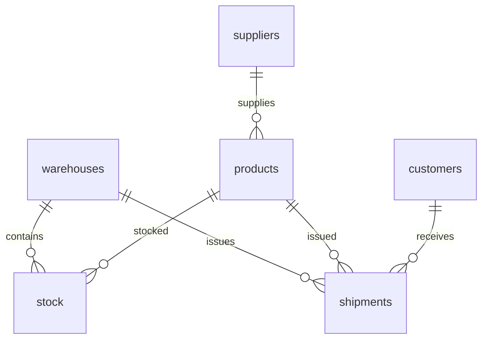

# Таск 2: PostgreSQL

Схема: `src/main/resources/db/migration/V1__warehouse.sql`.
Flyway выполняет её один раз и проверяет контрольную сумму при следующих стартах.
Изменения добавляйте новой миграцией V2, V3, не правьте уже применённую V1.

| Таблица | Поля | Представление Java |
| --- | --- | --- |
| suppliers | id UUID PK, name TEXT, contact TEXT, registration_order BIGINT IDENTITY | Supplier + JdbcSupplierRepository |
| customers | id UUID PK, name TEXT, contact TEXT, registration_order BIGINT IDENTITY | Customer + JdbcCustomerRepository |
| products | id UUID PK, name TEXT, type TEXT, supplier_id UUID FK, registration_order BIGINT IDENTITY | Product + JdbcProductRepository |
| warehouses | id INTEGER PK, name TEXT | DatabaseRows.WarehouseRow → Warehouse.name |
| stock | warehouse_id INTEGER FK, product_id UUID FK, quantity INTEGER | DatabaseRows.StockRow → Warehouse.stock |
| shipments | id BIGINT IDENTITY PK, warehouse_id INTEGER FK, product_id UUID FK, customer_id UUID FK, quantity INTEGER, created_at TIMESTAMPTZ | DatabaseRows.ShipmentRow → Shipment |

registration_order — техническое поле устойчивого порядка регистрации. JDBC
сортирует по нему; оно не входит в публичную карточку сущности. UUID хранится как
UUID. TIMESTAMPTZ читается как OffsetDateTime. ID и дата выдачи находятся в
ShipmentRow; доменный Shipment сохраняет исходный контракт первого этапа.
Warehouse объединяет три таблицы в одно состояние для проверки складских правил.

## Связи



Поставщик → товары: 1:N. Покупатель → выдачи и товар → выдачи: 1:N.
Покупатели ↔ товары: M:N через shipments. Повторные выдачи одного товара одному
покупателю допустимы. Составной PK `(warehouse_id, product_id)` запрещает два
остатка одной позиции на одном складе.

Приложение обслуживает один склад: CHECK warehouses.id = 1 закрепляет это
ограничение. Для нескольких складов нужно убрать CHECK и передавать warehouseId
в сервисы, запросы и UI. Искусственная связь 1:1 ради оценки не добавлялась.
При одном складе у товара есть 0..1 запись stock, до первого поступления её может не быть.

## Ограничения

PK обеспечивает уникальность, FK — существование связанных записей, NOT NULL —
обязательность. CHECK запрещает пустые названия/контакты, отрицательный остаток
и неположительное количество выдачи. Количество имеет диапазон Java int.
Индексы поддерживают запросы по поставщику и покупателю. Каскадного удаления
истории вместе с карточкой нет.

Пользовательские значения передаются JdbcTemplate через `?`, не конкатенируются
в SQL. Режим блокировки выбирается из внутренних констант FOR SHARE/FOR UPDATE.

## Транзакция

1. Сервис проверяет существование товара и покупателя.
2. JdbcWarehouseRepository.update открывает транзакцию.
3. SELECT id FROM warehouses WHERE id=1 FOR UPDATE блокирует строку склада.
4. Читается состояние и вызывается Warehouse.receive/ship.
5. Остатки обновляются через INSERT ... ON CONFLICT DO UPDATE; выдача добавляется INSERT.
6. COMMIT фиксирует оба изменения. Исключение приводит к ROLLBACK.

Другой запрос ждёт блокировку и читает актуальный остаток: две выдачи последней
единицы одновременно не проходят. Снимок при чтении защищён FOR SHARE от изменения
между SELECT остатков и SELECT истории. Прямые SQL-изменения должны соблюдать
тот же протокол блокировок.

save сохраняет контракт полной замены снимка. Для изменения через сервис всегда
используется update, иначе отдельные load и save не защищают от потерянного
обновления. Обычные операции дописывают историю, сохраняя её ID/даты. Явная полная
замена истории через низкоуровневый save может пересоздать строки; в API такой операции нет.

## SQL для защиты

```sql
SELECT p.name, p.type, s.name AS supplier, COALESCE(st.quantity, 0) AS quantity
FROM products p
JOIN suppliers s ON s.id = p.supplier_id
LEFT JOIN stock st ON st.product_id = p.id AND st.warehouse_id = 1
ORDER BY p.registration_order;

SELECT c.name AS customer, p.name AS product, sh.quantity, sh.created_at
FROM shipments sh
JOIN customers c ON c.id = sh.customer_id
JOIN products p ON p.id = sh.product_id
ORDER BY sh.id DESC;
```

На защите объясните отделение stock от products, составной ключ, отличие UUID
от порядкового номера и откат при ошибке записи истории после изменения остатка.
